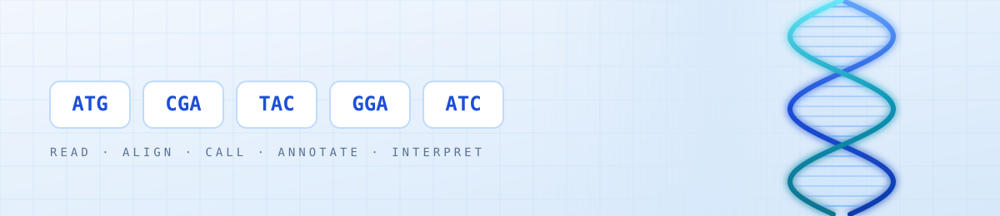

# Tharun Kumar J

**Computational Biology · Bioinformatics Pipelines · Long-read Genomics**

📍 Hosur, Tamil Nadu, India · ✉️ [tharunjayy@gmail.com](mailto:tharunjayy@gmail.com) · [LinkedIn](https://www.linkedin.com/in/tharunjay)

---

## 👋 What I do

M.Tech Biotechnology graduate building **reproducible, containerised NGS workflows** and asking careful questions of biological data. My work spans long-read variant calling, repeat-expansion genotyping, TB AMR detection, single-cell marker audits and applied machine learning.

I care about the part many pipelines skip: **can someone else rerun this, and do the numbers actually mean what we claim?**

> *"Life, uh, finds a base."* — from my browser tool, [Genome Analytics](#-repositories)

---

## 🧬 Featured result — one marker, two failure modes

A zero count for a cell-surface marker can be technical dropout **or** a real biological state. I audited CD20 (MS4A1) in 700 single immune cells and showed that the CD20-zero B cells are mostly **CD20-low plasmablasts**, not merely dropped-out reads.

<table>
  <tr>
    <td width="50%" align="center"><b>The evidence</b> </td>
    <td width="50%" align="center"><b>The atlas</b> </td>
  </tr>
</table>

[Read the full analysis →](https://github.com/TharunkumarJayakumar/computational-immunology) · [Executed notebook](https://github.com/TharunkumarJayakumar/computational-immunology/blob/main/notebooks/cd20_analysis.ipynb)

*34 of 95 B cells read zero for MS4A1. They keep CD79A (33/34), have higher UMI counts (4210 vs 3482), and are enriched for the plasmablast marker MZB1 (30/34 vs 21/61).*

---

## 📦 Repositories

| Project | What it is |
|---|---|
| [computational-immunology](https://github.com/TharunkumarJayakumar/computational-immunology) | Single-cell CD20 marker audit. Pinned environment, dataset SHA-256, 5 tests, executed notebook and CI. |
| [vcf-annotate-smk](https://github.com/TharunkumarJayakumar/vcf-annotate-smk) | Snakemake GRCh38 VCF filtering and Ensembl VEP annotation with per-rule Conda envs and CI. |
| [My_resume](https://github.com/TharunkumarJayakumar/My_resume) | Portfolio site — light-blue, evidence-led, with embedded figures and a tiny theme toggle. [Live site ↗](https://tharunkumarjayakumar.github.io/My_resume/) |

---

## 🛠 Toolkit

---

## 🔭 Currently

- Extending the annotation workflow into an end-to-end **FASTQ → filtered VCF** germline pipeline
- Building a **bulk RNA-seq differential expression** project on public GEO data
- Publishing **Genome Analytics**, a browser tool for FASTQ stats, BAM conversion and VCF inspection

[⬆ Back to top](#-what-i-do)

